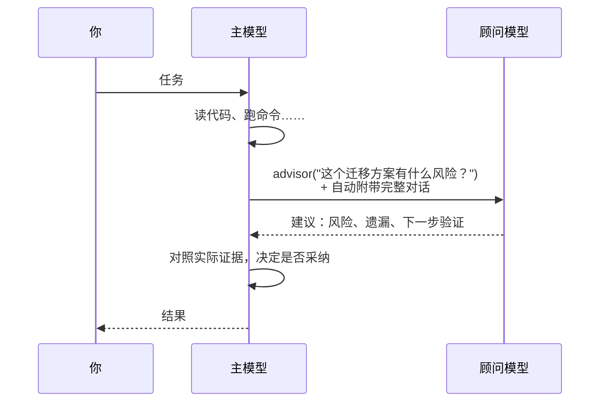

<div align="center">


# Pi Advisor

**给你的编码 Agent 配一位"顾问"——关键时刻，先听听第二意见。**

适用于 [Pi](https://pi.dev) 与 [DeepSeek Harness（dsh）](https://github.com/deepseek-ai/deepseek-harness)


[快速开始](#快速开始) · [使用](#使用) · [配置](#配置) · [上下文与费用](#上下文费用与限制) · [开发](#开发)

</div>

---

在主模型需要**规划方案**、**排查反复出现的错误**或**检查是否真正完成**时，它可以调用 `advisor` 工具，把当前对话交给另一个模型审阅，拿到建议后再自己继续干活。

灵感来自 [Claude Code Advisor](https://code.claude.com/docs/en/advisor)。本项目完全在客户端实现，**不依赖任何供应商的服务端 Advisor API**，因此可以任意搭配模型：跨供应商、自定义模型，甚至让同一个模型给自己当第二意见。



## 特性

- 🔌 **一个包，两个宿主**：同时是 Pi 扩展和 dsh 插件包，两端共用同一套核心逻辑。
- 🧠 **主模型自己决定何时咨询**：不会每轮都问，按需调用；你也可以在提示里直接要求它咨询。
- 🔒 **顾问只提建议**：顾问没有文件、终端或任何工具权限。
- 🪶 **省 token**：对话以紧凑 JSON 发送，去掉用量、时间戳、签名等对模型无用的附加信息；工具参数和结果保持完整。
- 📊 **用量可见**：`/advisor status` 显示累计咨询次数、token 与费用。
- ⏱️ **可控**：超时、输出上限、推理强度都可配置；支持取消，失败时给出明确信息，不会让主模型误以为已经审阅过。

## 快速开始

<table>
<tr><th>Pi</th><th>dsh</th></tr>
<tr valign="top"><td>

需要 Node.js 22.19+

```bash
# 在本项目目录
pi install .
```

重启 Pi 或执行 `/reload`，然后：

```text
/advisor
```

从列表中选一个模型即可。

</td><td>

需要 dsh 0.2.x、Node.js 24.22.3+ 和 pnpm

```bash
git clone <本仓库> pi-advisor
cd pi-advisor && npm install   # 生成 dist/
dsh plugin --profile web add ./pi-advisor
dsh web
```

然后在会话中：

```text
/advisor list
/advisor <provider>/<model-id>
```

</td></tr>
</table>

> [!TIP]
> Pi 也可以只临时加载一次，不安装：`pi -e ./extensions/index.ts`

## 使用

### 命令

| 命令 | Pi | dsh | 作用 |
| --- | :---: | :---: | --- |
| `/advisor` | ✅ 弹出选择列表 | ✅ 显示状态与用法 | — |
| `/advisor <provider>/<model-id>` | ✅ | ✅ | 选择顾问模型并保存 |
| `/advisor <model-id>` | ✅ | ✅ | ID 没有歧义时可省略 provider |
| `/advisor list [过滤词]` | — | ✅ | 列出可用模型（dsh 的命令没有选择菜单） |
| `/advisor status` | ✅ | ✅ | 当前模型、限额与累计用量 |
| `/advisor off` | ✅ | ✅ | 关闭顾问 |

- 默认**关闭**。选择会跨会话保存。
- Pi 中 `/advisor` 支持 **Tab 补全**模型名；模型 ID 以 `pi --list-models` 为准。
- 不提供 `opus` 这类会随版本漂移的简称，也不推断模型强弱。

### 让主模型去咨询

启用后由主模型自行判断何时调用。你也可以直接要求：

```text
先咨询 advisor，检查这个迁移方案的风险，然后继续实现。
完成后请让 advisor 检查测试证据，指出遗漏。
```

工具结果会标明 **`Reviewed`**（已审阅）、**`Declined`**（顾问拒绝回答）或 **`Advisor unavailable`**（调用失败），可展开查看完整建议。Pi 中咨询期间状态栏显示 `Advising`。

### 只对当前进程生效的覆盖

<details>
<summary><b>Pi：<code>--advisor</code> 参数</b></summary>

```bash
pi --advisor anthropic/claude-opus-4-6
pi --advisor off
```

覆盖保存的选择，只作用于当前进程。启动时会校验模型名，拼错会立即提示。非交互模式下 `/advisor` 输出当前状态，`/advisor <model>` 和 `/advisor off` 仍可修改保存的选择。

</details>

<details>
<summary><b>dsh：在 <code>cordis.patch.yml</code> 中覆盖插件行</b></summary>

在 profile 的 `cordis.patch.yml` 中加入：

```yaml
- id: pi-advisor
  name: pi-advisor/dsh
  config:
    model: deepseek-official/<model-id>   # off 表示关闭；省略则使用保存的选择
    maxTokens: 4096
    timeoutMs: 120000
    # reasoning: high                     # dsh 推理强度 ID，省略则用适配器默认
    # configPath: /path/to/advisor.json   # 自定义保存位置
```

作用等同于 Pi 的 `--advisor`：设置了 `model` 就覆盖保存的选择。

</details>

## 配置

选择保存在一个 JSON 文件中：

| 宿主 | 位置 |
| --- | --- |
| Pi | `~/.pi/agent/advisor.json`（设置了 `PI_CODING_AGENT_DIR` 时用该目录） |
| dsh | `~/.dsh/advisor.json`（设置了 `DSH_HOME` 时用该目录） |

```json
{
  "model": "anthropic/claude-opus-4-6",
  "maxTokens": 4096,
  "timeoutMs": 120000,
  "reasoning": "high"
}
```

| 字段 | 默认值 | 说明 |
| --- | --- | --- |
| `model` | `null` | `provider/model-id`，`null` 表示关闭 |
| `maxTokens` | `4096` | 顾问输出上限，同时不超过模型自身上限 |
| `timeoutMs` | `120000` | 单次咨询的最长时间，最多 30 分钟 |
| `reasoning` | Pi：`high`<br>dsh：适配器默认 | 推理强度，只对支持推理的模型生效；`off` 表示关闭 |

除 `model` 外都可以省略。`/advisor` 切换模型时只改 `model`，其他字段保留。配置文件无效时会提示警告并保持关闭，重新运行 `/advisor` 即可保存一份有效配置。

## 上下文、费用与限制

**发送了什么**

- 每次咨询发送主模型的系统提示和当前对话（文本、工具调用及结果）。已压缩的历史使用宿主生成的摘要；不会重新加载旧历史或其他分支，也不会读取没进入对话的磁盘文件。
- 对话以 JSON 文本引用的形式传递，可跨供应商调用；不转发供应商签名，图片标记为省略，因此目前适合文本和代码审查。
- 文本和工具结果**不会被截断**。超出顾问上下文窗口时返回不可用信息，可以压缩对话后再试。

**隐私与凭据**

- 直接复用宿主的模型注册表、认证（含 OAuth）、自定义供应商和请求配置，**不额外保存任何凭据**。
- 选择其他供应商的模型作为顾问，意味着上述对话内容会发送给该供应商。

**费用**

- 每次咨询都会产生额外的模型用量，**不计入**主模型的统计。
- 用量记录在工具结果中（Pi：`details.usage`），`/advisor status` 显示累计值（供应商返回费用时也显示费用）。

**可靠性**

- 输出达到上限时会明确提示"可能不完整"，超时会明确标注为超时。
- 支持取消：切换或关闭顾问、切换会话、卸载插件都会取消进行中的咨询。
- 同一会话同时只进行一次咨询；失败不会自动重试，主模型收到可读的错误后继续工作。

## 开发

```bash
npm install        # 同时通过 prepare 构建 dist/
npm run check      # 类型检查
npm test           # 先构建，再运行 Pi 与 dsh 两套测试
npm pack --dry-run
```

```text
extensions/
  core.ts        两端共用：配置、模型解析、对话序列化、结果解析
  index.ts       Pi 扩展
dsh/
  index.ts       dsh 插件
  types.ts       所用 dsh 接口的本地类型（插件不依赖任何 dsh 运行时包）
  cordis.patch.yml
dist/            npm run build 的产物，纯 JavaScript，供 dsh 加载
```

测试覆盖配置保存与校验、模型解析与补全、启用/关闭、对话传递与精简、限额与用量统计、错误/拒绝/截断/超时、取消时丢弃过期建议、dsh 插件的工具/命令/系统提示注册，以及构建产物能否在纯 Node 下加载。**不需要真实 API 凭据。**

## 许可证

[MIT](LICENSE)
